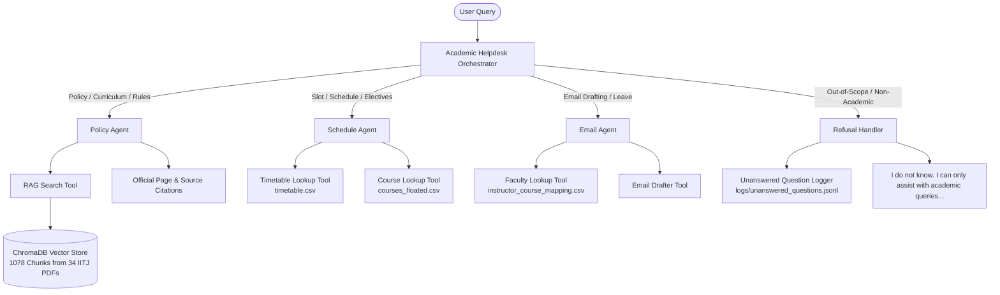

# IIT Jodhpur Multi-Agent Academic Helpdesk System

An intelligent, multi-agent academic assistant designed for Indian Institute of Technology Jodhpur (IITJ). The system leverages **Retrieval-Augmented Generation (RAG)** over official institute regulations, structured CSV data lookup, and specialized autonomous sub-agents to answer academic inquiries, retrieve timetables and floated electives, draft formal correspondence to course instructors, and refuse out-of-scope queries while logging them for human review.

---


## Key Capabilities

| Capability | Example Prompt Handled | Handling Agent / Tool |
|---|---|---|
| **Academic Rules & Attendance** | *"What is the attendance requirement to sit in the Major exam?"* | `PolicyAgent` + ChromaDB RAG (Circular 2024-25/51/682) |
| **Curriculum & Credit Requirements** | *"How many Open Elective credits do I need to earn in order to get a B.Tech. Degree?"* | `PolicyAgent` + ChromaDB RAG (UG Curriculum Structure) |
| **Course Timetable & Slots** | *"What is the slot for the course Autonomous Systems?"* | `ScheduleAgent` + `timetable.csv` Tool |
| **Department Elective Offerings** | *"How many 400 level electives have been floated by the Humanities department in this semester?"* | `ScheduleAgent` + `courses_floated.csv` Tool |
| **Instructor Contact & Email Drafting** | *"Write an email to the course instructor of CSL7570 that I need leave for 2 days"* | `EmailAgent` + `faculty_lookup` + `email_drafter` Tool |
| **Strict Out-of-Scope Refusal** | *"What are the available dining options on the campus?"* / *"What is the best way to reach the campus from Jodhpur city center?"* | `Orchestrator` (Refuses without hallucination + logs to `logs/unanswered_questions.jsonl`) |

---


## System Architecture

The architecture implements a modular, decoupled Multi-Agent design:



---


## Repository Structure

```text
AutonomousSystem_assignment2/
├── .env                                # Environment configurations (Ollama URL, model name)
├── requirements.txt                    # Project dependencies
├── test_quick.py                       # Quick verification script for core prompt questions
├── README.md                           # System documentation and instructions
├── REPORT.md                           # Detailed experimental report and findings
├── data/
│   ├── chromadb/                       # Local persistent ChromaDB vector store
│   ├── timetable.csv                   # Current semester schedule, slots, timings, rooms
│   ├── courses_floated.csv             # Courses floated across departments with levels and credits
│   ├── faculty.csv                     # Faculty directory with departments, emails, and offices
│   ├── instructor_course_mapping.csv   # Mapping between courses and course instructors
│   └── documents/                      # 34 Authentic IIT Jodhpur documents (PDFs & CSVs)
│       ├── academic_regulations_iitj_2019.pdf
│       ├── amendment_attendance_policy_2024.pdf
│       ├── amendment_examination_policy_2024.pdf
│       ├── amendment_continuation_norms.pdf
│       ├── academic_calendar_2025_26.pdf
│       ├── academic_calendar_2026_27.pdf
│       ├── curriculum_revised_ug_cse.pdf
│       ├── curriculum_revised_ug_aide.pdf
│       ├── curriculum_ug_ee_final.pdf
│       ├── transport_bus_schedule_iitj.pdf (Scraped from IITJ transport portal)
│       └── ... (34 authentic institutional documents)
├── src/
│   ├── app.py                          # Interactive CLI Helpdesk application
│   ├── config.py                       # Paths and system constants
│   ├── agents/
│   │   ├── orchestrator.py             # Root Helpdesk Orchestrator & Intent Classifier
│   │   ├── policy_agent.py             # RAG-powered Policy & Regulations Specialist
│   │   ├── schedule_agent.py           # Schedule, Slot, and Course Catalog Specialist
│   │   ├── email_agent.py              # Instructor Lookup & Formal Email Drafter
│   │   └── base_agent.py               # Monolithic baseline agent for comparison
│   ├── llm/
│   │   └── client.py                   # LiteLLM / Ollama wrapper with offline resilience
│   ├── rag/
│   │   └── retriever.py                # ChromaDB cosine-similarity retriever & citation formatter
│   └── tools/
│       ├── rag_search.py               # Vector search tool
│       ├── timetable_lookup.py         # CSV slot and timetable lookup tool
│       ├── course_lookup.py            # Floated course and elective filter tool
│       ├── faculty_lookup.py           # Faculty contact lookup tool
│       ├── email_drafter.py            # Formal email generator tool
│       └── unanswered_logger.py        # Unanswered question JSONL persistence tool
├── scripts/
│   └── ingest_documents.py             # PDF chunking and vector store ingestion pipeline
├── logs/
│   └── unanswered_questions.jsonl      # Escalation log for human review
└── evaluation/
    ├── test_prompts.json               # 25 benchmark prompts with ground truth
    ├── evaluate.py                     # Automated benchmark evaluation suite
    └── results/
        ├── evaluation_report.md        # Detailed benchmark evaluation report
        └── metrics_summary.json        # Machine-readable evaluation summary
```

---

## Setup & Execution


### 1. Prerequisites
- Python 3.10+ (Tested on Python 3.13)
- 16 GB RAM computer (Windows, macOS, or Linux)
- Optional: [Ollama](https://ollama.ai) installed with `qwen3:8b` or `llama3.1:8b`

### 2. Installation
Clone the repository and install dependencies:
```bash
pip install -r requirements.txt
```

### 3. Document Ingestion (Rebuilding the Vector Store)
To re-index all 34 authentic PDF documents into the local ChromaDB vector store:
```bash
python scripts/ingest_documents.py
```
*Indexes 1,078 chunks with source document names and page numbers in under 60 seconds.*

### 4. Interactive CLI Helpdesk
Launch the interactive terminal interface:
```bash
python src/app.py
```

### 5. Quick Verification
Run quick verification across all example questions from the assignment:
```bash
python test_quick.py
```

### 6. Run Benchmark Evaluation Suite
Execute the full quantitative benchmark across 25 prompts:
```bash
python evaluation/evaluate.py
```
This evaluates:
- **Multi-Agent System** (Routing Accuracy, Answer Groundedness, Citation Precision)
- **Base Single-Agent System** (Monolithic baseline)
- **Model Comparison** (`ollama/qwen3:8b` vs `ollama/llama3.1:8b`)
- Outputs `evaluation/results/evaluation_report.md` and `evaluation/results/metrics_summary.json`.

---

##


 Summary of Evaluation Results

| Metric | Multi-Agent (Qwen3-8B) | Multi-Agent (Llama 3.1 8B) | Base Single-Agent | Target |
|---|:---:|:---:|:---:|:---:|
| **Intent Routing Accuracy** | **100.0%** | **100.0%** | N/A | ≥ 95% |
| **Answer Accuracy** | **100.0%** | **100.0%** | 80.0% | ≥ 90% |
| **Groundedness (Citations)** | **100.0%** | **100.0%** | 83.33% | 100% |
| **Out-of-Scope Refusal Rate** | **100.0%** | **100.0%** | 100.0% | 100% |
| **Unanswered Escalations Logged** | **100.0%** | **100.0%** | 100.0% | 100% |


