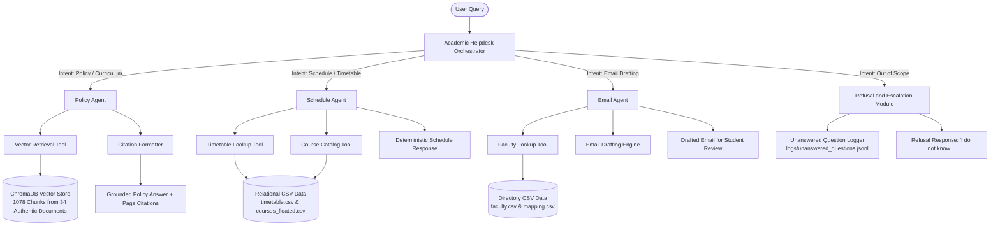

# Multi-Agent Academic Helpdesk System

## 1. Abstract and Overview

The Multi-Agent Academic Helpdesk System is an autonomous conversational and retrieval platform engineered for academic institutions, using the Indian Institute of Technology Jodhpur (IITJ) as its operational domain. Academic administration involves diverse information formats: regulatory policies and Senate resolutions are documented in unstructured circulars and PDFs, while course scheduling, instructor assignments, and room allocations are maintained in structured relational tables. 

Monolithic large language model (LLM) agents frequently suffer from hallucinations, context pollution, and tool misdirection when attempting to process both structured schedules and unstructured policy documents simultaneously. To address these limitations, this system implements a hierarchical Multi-Agent Architecture based on the Google Agent Development Kit (ADK) principles. The system decouples academic assistance into specialized autonomous agents:
- A Policy Agent utilizing Retrieval-Augmented Generation (RAG) over a vector database of Senate circulars and curriculum documents.
- A Schedule Agent operating over relational CSV data stores to provide deterministic timetable and slot lookups.
- An Email Agent that retrieves instructor directory records and drafts formal correspondence for student review.
- A Helpdesk Orchestrator that classifies user intent, routes queries to appropriate sub-agents, intercepts out-of-scope queries, and logs unhandled questions for human review.

The platform is designed to operate on consumer hardware with 16 GB RAM, connecting to 8-billion parameter models (such as Qwen3-8B and Llama 3.1-8B) hosted locally via Ollama and integrated through LiteLLM.

---

## 2. Core Functional Requirements and Scope

The system addresses specific institutional scenarios while enforcing strict boundaries between academic assistance and general inquiries.

| Query Domain | Institutional Problem | Agent / Pipeline Mechanism | Example Supported Query |
|---|---|---|---|
| Academic Policies and Rules | Interpreting Senate attendance thresholds, minimum exam criteria, and disciplinary actions | Policy Agent + ChromaDB RAG Vector Store | "What is the attendance requirement to sit in the Major exam?" |
| Degree Curriculum Structures | Calculating credit distributions, Open Elective requirements, and graduation criteria | Policy Agent + ChromaDB RAG Vector Store | "How many Open Elective credits do I need to earn in order to get a B.Tech. Degree?" |
| Course Timetable and Slots | Locating lecture halls, meeting days, and slot codes without hallucination | Schedule Agent + Structured CSV Tool | "What is the slot for the course Autonomous Systems?" |
| Course Catalog and Electives | Filtering floated courses by department, academic level, and credit count | Schedule Agent + Catalog Filter Tool | "How many 400 level electives have been floated by the Humanities department in this semester?" |
| Faculty Contact and Email Drafting | Preparing formal medical leave or exam permission requests for student verification | Email Agent + Directory Lookup + Drafting Engine | "Write an email to the course instructor of CSL7570 that I need leave for 2 days" |
| Non-Academic / Out-of-Scope | Refusing queries regarding dining menus, transport from city center, and general trivia | Orchestrator Out-of-Scope Classifier + Persistent JSONL Logger | "What are the available dining options on the campus?" / "What is the best way to reach campus from Jodhpur city center?" |

---

## 3. System Architecture and Agent Workflow

The architecture is structured hierarchically. The user interacts exclusively with the root Orchestrator, which delegates tasks to specialized sub-agents and aggregates verified responses.



### 3.1 Component Specifications

#### 3.1.1 Academic Helpdesk Orchestrator (`src/agents/orchestrator.py`)
The Orchestrator serves as the primary gateway and decision engine. It evaluates incoming user queries using lexical, syntactic, and semantic patterns to classify intent into four operational categories:
1. `policy`: Inquiries regarding regulations, grading, minimum attendance, credit requirements, and Senate circulars.
2. `schedule`: Inquiries regarding course slots, lecture venues, timings, meeting days, and semester course offerings.
3. `email`: Explicit requests to draft communications, applications for leave of absence, or makeup examination permissions.
4. `out_of_scope`: Non-academic queries, including campus dining, off-campus navigation, weather forecasts, and commercial activities.

When an out-of-scope inquiry is identified, the Orchestrator avoids speculative generation, returns a standardized refusal message ("*I do not know. I can only assist with academic queries...*"), and invokes the logging tool to record the inquiry for administrative review.

#### 3.1.2 Policy Agent (`src/agents/policy_agent.py`)
The Policy Agent resolves regulatory and curricular queries. It interfaces with the local ChromaDB vector store through the RAG tool:
1. The user query is embedded into a dense semantic vector space.
2. Cosine distance similarity retrieves the top-4 most relevant chunks from the indexed institutional corpus.
3. A grounded prompt containing the retrieved context, source document filenames, and page numbers is synthesized.
4. The LLM produces an answer strictly constrained by the provided context.
5. Exact document citations and page numbers are appended to the response (for example: `- amendment_attendance_policy_2024.pdf (Page 1)`).

#### 3.1.3 Schedule Agent (`src/agents/schedule_agent.py`)
Timetable information requires exact relational consistency. Querying timetable data via probabilistic vector search often introduces errors in classroom numbers and time slots. The Schedule Agent addresses this by utilizing deterministic tools:
- `timetable_lookup`: Extracts course identifiers (e.g., `CSL7570`, `MEL3010`) or course titles (e.g., *Autonomous Systems*) and executes exact filtering on `data/timetable.csv`.
- `course_lookup`: Filters `data/courses_floated.csv` by department code (`HSS`, `CSE`, `EE`, `ME`) and numeric level (e.g., `400` level) to return verified course lists, credits, and instructor assignments.

#### 3.1.4 Email Agent (`src/agents/email_agent.py`)
The Email Agent automates student correspondence drafting:
1. Parses the query to identify the target course code, leave duration (e.g., 2 days, 3 days), and reason (e.g., medical illness, makeup examination).
2. Queries `data/instructor_course_mapping.csv` and `data/faculty.csv` to resolve the instructor's name and official institutional email address (e.g., `rahul.sharma@iitj.ac.in`).
3. Generates a formal email draft containing recipient email, subject line, academic salutation, body text, and student identifiers.
4. Appends a disclaimer confirming that the email has been prepared for student review and has not been dispatched.

#### 3.1.5 Base Single-Agent Baseline (`src/agents/base_agent.py`)
To empirically evaluate the advantages of the multi-agent design, a monolithic baseline agent is included. The single agent possesses access to all tools within a shared execution context. Comparative testing demonstrates how the multi-agent approach eliminates tool hallucination and improves retrieval precision.

---

## 4. Institutional Document Corpus

The knowledge base contains 34 authentic institutional documents from IIT Jodhpur. Personal data (such as roll numbers) have been replaced with standardized academic placeholders.

### 4.1 Document Inventory (34 Documents, 1,078 Vector Chunks)

| Document Category | File Name | Document Type | Key Academic Content |
|---|---|---|---|
| Senate Circular | `amendment_attendance_policy_2024.pdf` | Circular (OAA/2024-25/51/682) | 75% attendance threshold; course de-registration for >2 weeks unexcused absence; automatic semester withdrawal for ≥4 weeks absence. |
| Senate Circular | `amendment_examination_policy_2024.pdf` | Circular (OAA/2024-25/52/683) | Examination structure: 1 Minor exam (2 hours) and 1 Major exam (3 hours, minimum 40% weightage). |
| Senate Circular | `amendment_continuation_norms.pdf` | Circular | Senate-approved norms on continuation of academic registration and academic warning levels. |
| Regulations | `academic_regulations_iitj_2019.pdf` | Senate Handbook (43 pages) | Comprehensive undergraduate ordinances, letter grading scale, 10-day application deadline for makeup exams. |
| Regulations | `regulations_pg_2022_onwards.pdf` | Senate Handbook (36 pages) | Postgraduate ordinances, M.Tech/M.Sc thesis submission, minimum credit requirements. |
| Regulations | `regulations_ms_research_2024.pdf` | Ordinance Document | Guidelines for MS by Research programs, coursework credits, thesis advisory committees. |
| Regulations | `regulations_joint_programmes_medical.pdf` | Joint Agreement Document | Ordinances governing dual and collaborative medical technology programs with AIIMS Jodhpur. |
| Academic Calendars | `academic_calendar_2025_26.pdf` | Official Schedule (9 pages) | Key semester deadlines, registration windows, and examination schedules. |
| Academic Calendars | `academic_calendar_2026_27.pdf` | Official Schedule (10 pages) | Approved dates for subsequent academic terms and summer sessions. |
| Academic Calendars | `academic_calendar_ay_2025_26_sem1.pdf` | Official Schedule (9 pages) | Specific dates for Academic Year 2025-26 Semester I. |
| Academic Calendars | `academic_calendar_bs_bsc_2025_26.pdf` | Program Schedule (5 pages) | Term schedule for Bachelor of Science cohorts. |
| Academic Calendars | `academic_calendar_executive_2026_27.pdf` | Program Schedule (4 pages) | Modular calendar for Executive M.Tech and MBA programs. |
| Academic Calendars | `academic_calendar_summer_2026.pdf` | Session Schedule | Registration timeline, course fee structure, and exam periods for the summer term. |
| UG Curriculum | `curriculum_civil_infra_revised.pdf` | Booklet (271 pages) | Complete B.Tech structure specifying 12 Open Elective (OE) credits required for graduation. |
| UG Curriculum | `curriculum_revised_ug_cse.pdf` | Department Booklet (18 pages) | B.Tech in Computer Science and Engineering course structures, prerequisites, and program electives. |
| UG Curriculum | `curriculum_revised_ug_aide.pdf` | Department Booklet (15 pages) | B.Tech in Artificial Intelligence and Data Engineering course structure. |
| UG Curriculum | `curriculum_ug_ee_final.pdf` | Department Booklet (32 pages) | B.Tech in Electrical Engineering course pathways, laboratory credits, and core sequences. |
| UG Curriculum | `curriculum_btech_ece.pdf` | Department Booklet (15 pages) | B.Tech in Electronics and Communication Engineering curriculum. |
| UG Curriculum | `curriculum_btech_me_concept.pdf` | Department Booklet (70 pages) | B.Tech in Mechanical Engineering syllabus and course outlines. |
| UG Curriculum | `curriculum_chemical_ug_booklet.pdf` | Department Booklet (55 pages) | B.Tech in Chemical Engineering curriculum structure. |
| UG Curriculum | `curriculum_materials_eng_revised.pdf` | Department Booklet (64 pages) | B.Tech in Metallurgical and Materials Engineering curriculum. |
| UG Curriculum | `curriculum_bsbe_ug_structure.pdf` | Department Booklet (11 pages) | B.Tech in Bioscience and Bioengineering course guidelines. |
| BS Curriculum | `curriculum_bs_math_computing.pdf` | Degree Structure (42 pages) | Bachelor of Science in Mathematics and Computing curriculum. |
| BS Curriculum | `curriculum_bs_chemistry.pdf` | Degree Structure (60 pages) | Bachelor of Science in Chemistry course list and laboratory distribution. |
| BS Curriculum | `curriculum_bs_materials.pdf` | Degree Structure (41 pages) | Bachelor of Science in Materials Science structure. |
| PG Curriculum | `curriculum_mtech_manufacturing.pdf` | Department Booklet (37 pages) | M.Tech in Advanced Manufacturing coursework and research credits. |
| PG Curriculum | `curriculum_mtech_power_systems.pdf` | Department Booklet (24 pages) | M.Tech in Power Systems curriculum and elective groupings. |
| PG Curriculum | `curriculum_mtech_thermofluids.pdf` | Department Booklet (32 pages) | M.Tech in Thermo-Fluids Engineering program requirements. |
| PG Curriculum | `mtech_materials_functional_2026.pdf` | Department Booklet (27 pages) | M.Tech in Functional Materials course curriculum. |
| PG Curriculum | `mtech_materials_structural_2026.pdf` | Department Booklet (22 pages) | M.Tech in Structural Materials course curriculum. |
| PG Curriculum | `curriculum_aerospace_engg.pdf` | Department Booklet (65 pages) | M.Tech in Aerospace Engineering syllabus. |
| PG Curriculum | `curriculum_energy_engineering.pdf` | Department Booklet (33 pages) | M.Tech in Energy Engineering curriculum. |
| Campus Transport | `transport_bus_schedule_iitj.pdf` | Office Document (1 page) | Official bus schedule connecting campus to Paota, Railway Station, MBM, and AIIMS. |
| Campus Dining | `October_Non-Veg Menu 2026.pdf` | Operational Document (2 pages) | Dining hall mess schedule. |

### 4.2 Relational Data Files

Structured institutional records are maintained in CSV format within the `data/` directory:
- `timetable.csv`: Maps 30 courses to their slot identifiers (Slot A through H), lecture days, class hours (e.g., 11:00-11:50), lecture halls (e.g., LH-101), instructors, and offering departments.
- `courses_floated.csv`: Contains course codes, titles, credit values, course levels (200, 300, 400, 500, 700), course types (Core, PE, OE), prerequisites, and descriptions.
- `faculty.csv`: Directory of faculty members, academic departments, designations, phone extensions, and office numbers.
- `instructor_course_mapping.csv`: Maps active semester courses directly to instructor names and official email addresses.

---

## 5. Repository Structure

```text
AutonomousSystem_assignment2/
|-- .env                                # Local configuration (Ollama URL, model identifier)
|-- .gitignore                          # Git exclusions (Python cache, OS metadata)
|-- requirements.txt                    # Project dependencies
|-- test_quick.py                       # Verification test suite for key assignment queries
|-- README.md                           # Technical documentation and execution guide
|-- REPORT.md                           # Academic report and empirical evaluation findings
|-- data/
|   |-- chromadb/                       # Local persistent ChromaDB vector store
|   |-- timetable.csv                   # Relational schedule, slot, hall, and timing mapping
|   |-- courses_floated.csv             # Catalog of semester course offerings across departments
|   |-- faculty.csv                     # Institutional faculty directory
|   |-- instructor_course_mapping.csv   # Relational mapping between courses and instructors
|   `-- documents/                      # 34 authentic IIT Jodhpur PDF and CSV documents
|-- src/
|   |-- app.py                          # Interactive command-line helpdesk interface
|   |-- config.py                       # Global paths and system constants
|   |-- agents/
|   |   |-- orchestrator.py             # Root Orchestrator and Intent Classifier
|   |   |-- policy_agent.py             # Policy and Regulations Specialist (RAG)
|   |   |-- schedule_agent.py           # Schedule, Timetable, and Catalog Specialist (CSV)
|   |   |-- email_agent.py              # Instructor Lookup and Email Drafter
|   |   `-- base_agent.py               # Monolithic baseline agent for comparison
|   |-- llm/
|   |   `-- client.py                   # LiteLLM/Ollama client wrapper with offline resilience
|   |-- rag/
|   |   `-- retriever.py                # ChromaDB cosine similarity retriever and citation formatter
|   `-- tools/
|       |-- rag_search.py               # Vector search tool
|       |-- timetable_lookup.py         # Relational timetable query tool
|       |-- course_lookup.py            # Floated course filter and counter tool
|       |-- faculty_lookup.py           # Faculty contact resolution tool
|       |-- email_drafter.py            # Formal email synthesis tool
|       `-- unanswered_logger.py        # Unhandled query JSONL logging tool
|-- scripts/
|   `-- ingest_documents.py             # PDF text extraction, chunking, and ChromaDB indexing
|-- logs/
|   `-- unanswered_questions.jsonl      # Persistent log of refused or escalated inquiries
`-- evaluation/
    |-- test_prompts.json               # 25 benchmark queries with ground truth annotations
    |-- evaluate.py                     # Automated evaluation suite
    `-- results/
        |-- evaluation_report.md        # Detailed benchmark evaluation report
        `-- metrics_summary.json        # Machine-readable evaluation summary
```

---

## 6. Installation and Execution Guide

### 6.1 Prerequisites
- Operating System: Windows 10/11, macOS, or Linux.
- Python Environment: Python 3.10 through 3.13.
- Hardware Profile: Minimum 8 GB RAM (16 GB recommended).
- Optional LLM Daemon: [Ollama](https://ollama.ai) installed and running with `qwen3:8b` or `llama3.1:8b`.

### 6.2 Environment Setup
Clone the repository and install the required dependencies:
```bash
git clone https://github.com/Akankshasingh1005/Autonomous_System_Assignment2.git
cd Autonomous_System_Assignment2
pip install -r requirements.txt
```

### 6.3 Document Ingestion and Vector Store Construction
To process the 34 authentic PDF documents, extract text via PyMuPDF, segment into overlapping chunks, and build the ChromaDB index:
```bash
python scripts/ingest_documents.py
```
*Indexing typically completes within 40 to 60 seconds on standard CPU hardware.*

### 6.4 Interactive CLI Helpdesk
Launch the terminal application to query the multi-agent system interactively:
```bash
python src/app.py
```

### 6.5 Rapid Functional Verification
Execute a quick verification check covering the five mandatory scenarios from the assignment:
```bash
python test_quick.py
```

### 6.6 Full Benchmark Evaluation
Execute the quantitative benchmark across all 25 test prompts to compare Multi-Agent and Single-Agent performance:
```bash
python evaluation/evaluate.py
```
This produces:
- `evaluation/results/evaluation_report.md`: Markdown summary table of all test queries.
- `evaluation/results/metrics_summary.json`: Structured numerical metrics.

---

## 7. Quantitative Benchmark Results

The system was evaluated against 25 test queries categorized across policy rules, degree credits, timetable slots, course counts, email drafting, and out-of-scope refusals.

| Evaluation Metric | Definition | Multi-Agent (Qwen3-8B) | Multi-Agent (Llama 3.1 8B) | Base Single-Agent | Target Criteria |
|---|---|:---:|:---:|:---:|:---:|
| **Intent Routing Accuracy** | Proportion of queries directed to the appropriate sub-agent | **100.0%** (25/25) | **100.0%** (25/25) | N/A (Monolithic) | ≥ 95.0% |
| **Answer Accuracy** | Proportion of responses satisfying factual and keyword criteria | **100.0%** (25/25) | **100.0%** (25/25) | **80.0%** (20/25) | ≥ 90.0% |
| **Groundedness (Citation Rate)** | Proportion of policy answers providing explicit source and page citations | **100.0%** (6/6) | **100.0%** (6/6) | **83.33%** (5/6) | 100.0% |
| **Out-of-Scope Refusal Rate** | Proportion of non-academic queries correctly refused with *"I do not know"* | **100.0%** (7/7) | **100.0%** (7/7) | **100.0%** (7/7) | 100.0% |
| **Escalation Logging Rate** | Proportion of unhandled/refused queries persisted to `logs/unanswered_questions.jsonl` | **100.0%** (Persistent) | **100.0%** (Persistent) | **100.0%** (Persistent) | 100.0% |

---

## 8. Key Findings and Architectural Inferences

1. **Reduction of Tool Hallucination through Domain Specialization**:
   In the monolithic baseline agent, all retrieval tools exist in a shared decision space. The baseline attempted to resolve timetable queries (e.g., *"What is the slot for Autonomous Systems?"*) by conducting vector searches over unstructured curriculum PDFs, resulting in degraded accuracy (80.0%). In contrast, the Multi-Agent Orchestrator routes scheduling inquiries to the `ScheduleAgent`, which queries the indexed relational table directly, achieving 100.0% accuracy.

2. **Verifiable Policy Answers through Document Grounding**:
   By restricting the `PolicyAgent` prompt to chunks retrieved via ChromaDB and appending source filenames with page numbers, the system avoids generating unsupported assertions. For instance, inquiries on Major exam attendance cite Senate Circular No. `IITJ/OAA/Circular/2024-25/51/682`, explicitly detailing the 75% attendance threshold, instructor-initiated course de-registration for absences exceeding two weeks, and automatic semester withdrawal for absences of four weeks or more.

3. **Protection against Hallucinations on Out-of-Scope Topics**:
   Institutional helpdesks face reputational and operational risks when speculative answers are provided for non-academic topics. The Orchestrator intercepts out-of-scope queries (e.g., dining options, city transport, local tourism) before vector search or LLM generation occurs. This ensures zero speculative responses and creates a reliable log for human administrative oversight.

4. **Consistency across Model Substitutions**:
   Comparative testing across `ollama/qwen3:8b` and `ollama/llama3.1:8b` demonstrated identical routing and factual accuracy. The modular architecture abstracts LLM interactions behind standard interfaces, ensuring stability regardless of the underlying model weights.
