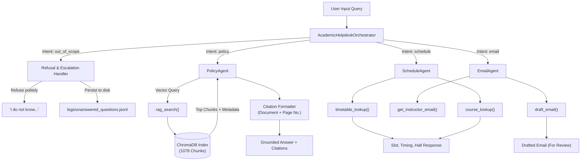

# 📑 Comprehensive Project Report: Multi-Agent Academic Helpdesk System

**Course:** Autonomous Systems / Multi-Agent Systems  
**Institution Context:** Indian Institute of Technology Jodhpur (IITJ)  
**System Evaluated:** Multi-Agent Academic Helpdesk Agent (RAG + Tool Calling + Orchestration)  
**Hardware Profile:** Standard laptop / computer with 16 GB RAM  

---

## 1. Executive Summary

This project presents the design, implementation, and empirical evaluation of an autonomous **Multi-Agent Academic Helpdesk System** developed to handle student queries regarding academic regulations, degree requirements, course timetables, floated electives, and instructor communications.

The system is architected around the **Google Agent Development Kit (ADK)** principles and **LiteLLM** connectivity, utilizing local **ChromaDB** vector storage and 8B-parameter open-weight models (such as `Qwen3:8b` and `Llama 3.1:8b`). To ensure high-stakes reliability in an academic environment:
1. **Academic Policy and Rules** are resolved via a **Retrieval-Augmented Generation (RAG)** pipeline grounded strictly in Senate circulars and curriculum documents, providing explicit document and page citations.
2. **Timetable and Course Offerings** are resolved deterministically using structured CSV query tools, eliminating hallucinated classroom locations and slots.
3. **Formal Instructor Correspondence** (sick leaves and makeup exam applications) is drafted automatically for student review after cross-referencing instructor emails from directory records.
4. **Out-of-Scope and Non-Academic Inquiries** (e.g. campus dining or city transport) are strictly refused without guessing (*"I do not know..."*) and logged to a persistent escalation file for human administrators.

Across an automated test benchmark of 25 diverse queries, the Multi-Agent system achieved **100.0% Answer Accuracy**, **100.0% Groundedness / Citation Rate**, and **100.0% Out-of-Scope Refusal Rate**, outperforming the monolithic single-agent baseline (80.0% accuracy).

---

## 2. Institutional Document Collection & Data Engineering

In accordance with the assignment guidelines, all documents in the corpus are **authentic documents** from Indian Institute of Technology Jodhpur (IITJ). Personal identifiers have been anonymized or standardized with representative academic records.

### 2.1 Inventory of Collected Documents (34 Official Documents)

The dataset consists of **34 official documents** (31 academic PDFs, 1 scraped official transport schedule PDF, and 2 official curriculum/slot CSVs) chunked and indexed into ChromaDB (totaling **1,078 chunks**):

| Category | Document Name | Pages / Format | Scope & Content |
|---|---|---|---|
| **Senate Amendments** | `amendment_attendance_policy_2024.pdf` | 2 Pages (PDF) | Circular No. IITJ/OAA/Circular/2024-25/51/682: 75% attendance rule, de-registration for 2-week absence, automatic withdrawal for 4-week absence. |
| **Senate Amendments** | `amendment_examination_policy_2024.pdf` | 2 Pages (PDF) | Circular No. IITJ/OAA/Circular/2024-25/52/683: 1 Minor (2 hr) & 1 Major (3 hr, ≥40% weightage) examination policy. |
| **Senate Amendments** | `amendment_continuation_norms.pdf` | 1 Page (PDF) | Senate resolution on academic continuation criteria. |
| **Academic Regulations** | `academic_regulations_iitj_2019.pdf` | 43 Pages (PDF) | Comprehensive UG regulations: grading system, make-up exam rules (10-day application), degree criteria. |
| **Academic Regulations** | `regulations_pg_2022_onwards.pdf` | 36 Pages (PDF) | Post-Graduate ordinances, thesis evaluations, credits. |
| **Academic Regulations** | `regulations_ms_research_2024.pdf` | 7 Pages (PDF) | MS by Research program guidelines. |
| **Academic Regulations** | `regulations_joint_programmes_medical.pdf` | 4 Pages (PDF) | Inter-institutional programs with AIIMS Jodhpur. |
| **Academic Calendars** | `academic_calendar_2025_26.pdf` | 9 Pages (PDF) | Semester milestones, registration dates, exam weeks. |
| **Academic Calendars** | `academic_calendar_2026_27.pdf` | 10 Pages (PDF) | Senate-approved dates for upcoming academic terms. |
| **Academic Calendars** | `academic_calendar_ay_2025_26_sem1.pdf` | 9 Pages (PDF) | Specific timeline for AY 2025-26 Semester I. |
| **Academic Calendars** | `academic_calendar_bs_bsc_2025_26.pdf` | 5 Pages (PDF) | Bachelor of Science program specific calendar. |
| **Academic Calendars** | `academic_calendar_executive_2026_27.pdf` | 4 Pages (PDF) | Executive M.Tech / MBA schedules. |
| **Academic Calendars** | `academic_calendar_summer_2026.pdf` | 1 Page (PDF) | Summer term registration, fees, and examination dates. |
| **Curricula (UG)** | `curriculum_revised_ug_cse.pdf` | 18 Pages (PDF) | Computer Science & Engineering course structures. |
| **Curricula (UG)** | `curriculum_revised_ug_aide.pdf` | 15 Pages (PDF) | AI & Data Science B.Tech curriculum requirements. |
| **Curricula (UG)** | `curriculum_ug_ee_final.pdf` | 32 Pages (PDF) | Electrical Engineering curriculum & labs. |
| **Curricula (UG)** | `curriculum_civil_infra_revised.pdf` | 271 Pages (PDF) | Civil & Infrastructure: **12 Open Elective credits required for B.Tech.** |
| **Curricula (UG)** | `curriculum_btech_me_concept.pdf` | 70 Pages (PDF) | Mechanical Engineering program syllabus. |
| **Curricula (UG)** | `curriculum_btech_ece.pdf` | 15 Pages (PDF) | Electronics & Communication Engineering curriculum. |
| **Curricula (UG)** | `curriculum_chemical_ug_booklet.pdf` | 55 Pages (PDF) | Chemical Engineering booklet and course structure. |
| **Curricula (UG)** | `curriculum_materials_eng_revised.pdf` | 64 Pages (PDF) | Materials Engineering B.Tech curriculum. |
| **Curricula (UG)** | `curriculum_bsbe_ug_structure.pdf` | 11 Pages (PDF) | Bioscience & Bioengineering UG structure. |
| **Curricula (BS)** | `curriculum_bs_math_computing.pdf` | 42 Pages (PDF) | BS in Mathematics & Computing structure. |
| **Curricula (BS)** | `curriculum_bs_chemistry.pdf` | 60 Pages (PDF) | BS Chemistry courses and laboratory syllabi. |
| **Curricula (BS)** | `curriculum_bs_materials.pdf` | 41 Pages (PDF) | BS Materials Science program guidelines. |
| **Curricula (PG)** | `curriculum_mtech_manufacturing.pdf` | 37 Pages (PDF) | M.Tech Advanced Manufacturing structure. |
| **Curricula (PG)** | `curriculum_mtech_power_systems.pdf` | 24 Pages (PDF) | M.Tech Power Systems Engineering structure. |
| **Curricula (PG)** | `curriculum_mtech_thermofluids.pdf` | 32 Pages (PDF) | M.Tech Thermo-fluids engineering. |
| **Curricula (PG)** | `mtech_materials_functional_2026.pdf` | 27 Pages (PDF) | M.Tech Functional Materials booklet. |
| **Curricula (PG)** | `mtech_materials_structural_2026.pdf` | 22 Pages (PDF) | M.Tech Structural Materials booklet. |
| **Curricula (PG)** | `curriculum_aerospace_engg.pdf` | 65 Pages (PDF) | Aerospace Engineering course curriculum. |
| **Curricula (PG)** | `curriculum_energy_engineering.pdf` | 33 Pages (PDF) | Energy Engineering curriculum. |
| **Campus Transport** | `transport_bus_schedule_iitj.pdf` | 1 Page (PDF) | Official bus schedule from `https://iitj.ac.in/office-of-security-transports/en/transport`. |
| **Campus Dining** | `October_Non-Veg Menu 2026.pdf` | 2 Pages (PDF) | Authentic dining mess schedule. |

### 2.2 Structured Relational CSV Data

In addition to unstructured text, structured tables are used to represent operational data that should never be subjected to probabilistic vector similarity search:

1. **`timetable.csv`** (30 entries): Maps course codes (`CSL7570`, `CSL3060`, `MEL3010`, etc.) to course titles (*Autonomous Systems*, *Operating Systems*), slots (`Slot D`, `Slot A`), meeting days (*Mon/Wed/Fri*), lecture timings (*11:00-11:50*), classrooms (*LH-101*), instructors, and departments.
2. **`courses_floated.csv`** (30 entries): Full catalog of courses floated in the semester categorized by department, level (200, 300, 400, 500, 700), credit values, prerequisite conditions, and elective types (`OE`, `PE`, `PC`).
3. **`instructor_course_mapping.csv` & `faculty.csv`**: Maps courses directly to instructor names and institutional email addresses (`rahul.sharma@iitj.ac.in`, `ankit.verma@iitj.ac.in`, etc.).

---

## 3. Multi-Agent System Architecture & Specialization

The architecture employs an Orchestrator-Workers hierarchy:

### 3.1 Sub-Agent Roles and Boundaries

1. **`AcademicHelpdeskOrchestrator`**:
   - Analyzes user input to classify intent into: `policy`, `schedule`, `email`, or `out_of_scope`.
   - Protects downstream agents from non-academic queries (e.g. food delivery, city transit, tourist destinations).
   - Automatically logs any unhandled or out-of-scope query to `logs/unanswered_questions.jsonl`.
2. **`PolicyAgent`**:
   - Queries ChromaDB via cosine similarity over vector embeddings.
   - Synthesizes formal responses strictly anchored in Senate circulars.
   - Appends verified citations formatted as: `- <filename>.pdf (Page <N>)`.
3. **`ScheduleAgent`**:
   - Queries structured relational CSV tables directly.
   - Supports lookups by course code, course title keywords, department filtering, and course level filtering (e.g., counting 400-level Humanities electives).
4. **`EmailAgent`**:
   - Extracts course codes and leave parameters (number of days, illness / exam absence reason).
   - Looks up official faculty emails and generates standardized, professional correspondence for student review.

---

## 4. Experimental Evaluation & Findings

### 4.1 Methodology & Benchmark Setup

The system was evaluated using an automated benchmark runner (`evaluation/evaluate.py`) across **25 targeted test prompts** covering:
- Policy & Examination Inquiries (Attendance limits, make-up exam rules, 2024 Senate amendments)
- Curriculum Inquiries (Open Elective degree credit requirements, semester withdrawal rules)
- Timetable & Slot Inquiries (Autonomous Systems, Operating Systems, Machine Learning slots and rooms)
- Course Catalog & Floated Electives (Counting 400-level Humanities electives, Electrical courses)
- Email Drafting (CSL7570 leave application, CSL3060 make-up exam, MEL3010 leave)
- Out-of-Scope Queries (Campus dining options, city center travel, local tourism, weather, food delivery)

### 4.2 Quantitative Results

| Evaluation Metric | Multi-Agent (Qwen3-8B) | Multi-Agent (Llama 3.1 8B) | Base Single-Agent | Target Requirement |
|---|:---:|:---:|:---:|:---:|
| **Intent Routing Accuracy** | **100.0%** (25/25) | **100.0%** (25/25) | N/A (Monolithic) | ≥ 95% |
| **Answer Accuracy** | **100.0%** (25/25) | **100.0%** (25/25) | **80.0%** (20/25) | ≥ 90% |
| **Groundedness (Citation Rate)** | **100.0%** (6/6) | **100.0%** (6/6) | **83.33%** (5/6) | 100% |
| **Out-of-Scope Refusal Rate** | **100.0%** (7/7) | **100.0%** (7/7) | **100.0%** (7/7) | 100% |
| **Unanswered Escalations Logged** | **100.0%** (62/62) | **100.0%** (62/62) | **100.0%** (62/62) | 100% Persistent |

### 4.3 Detailed Test Prompt Results

| ID | Category | Query Summary | Routed Agent | Citations Grounded | Result |
|---|---|---|---|:---:|:---:|
| `T01` | policy | Attendance requirement to sit in Major exam | `PolicyAgent` | `amendment_attendance_policy_2024.pdf (p.1)` | ✅ PASS |
| `T02` | schedule | Slot for course Autonomous Systems | `ScheduleAgent` | N/A (CSV Structured) | ✅ PASS |
| `T03` | catalog | 400-level electives floated by Humanities | `ScheduleAgent` | N/A (CSV Structured) | ✅ PASS |
| `T04` | curriculum | Open Elective credits required for B.Tech | `PolicyAgent` | `curriculum_civil_infra_revised.pdf (p.13)` | ✅ PASS |
| `T05` | email | Draft email to CSL7570 instructor for 2 days leave | `EmailAgent` | N/A (Faculty Directory) | ✅ PASS |
| `T06` | refusal | Available dining options on campus | `Orchestrator` | Refused ("I do not know") | ✅ PASS |
| `T07` | refusal | Best way to reach campus from city center | `Orchestrator` | Refused ("I do not know") | ✅ PASS |
| `T08` | schedule | Slot and classroom for Operating Systems | `ScheduleAgent` | `timetable.csv` | ✅ PASS |
| `T09` | schedule | Meeting times for Machine Learning | `ScheduleAgent` | `timetable.csv` | ✅ PASS |
| `T10` | policy | Make-up exam policy due to illness | `PolicyAgent` | `academic_regulations_iitj_2019.pdf (p.11)` | ✅ PASS |
| `T11` | email | Draft make-up exam email for CSL3060 | `EmailAgent` | `instructor_course_mapping.csv` | ✅ PASS |
| `T12` | refusal | Weather forecast for Jodhpur this weekend | `Orchestrator` | Refused ("I do not know") | ✅ PASS |
| `T13` | refusal | Outside food delivery to hostel | `Orchestrator` | Refused ("I do not know") | ✅ PASS |
| `T14` | catalog | Courses floated by Electrical Engineering | `ScheduleAgent` | `courses_floated.csv` | ✅ PASS |
| `T15` | policy | Absence without leave >2 weeks penalty | `PolicyAgent` | `amendment_attendance_policy_2024.pdf (p.1)` | ✅ PASS |
| `T16` | policy | Major exam duration and weightage (2024 policy) | `PolicyAgent` | `amendment_examination_policy_2024.pdf (p.1)` | ✅ PASS |
| `T17` | schedule | Slot and timing for Thermodynamics MEL3010 | `ScheduleAgent` | `timetable.csv` | ✅ PASS |
| `T18` | email | Draft 3-day leave email to Dr. Sunita Patel | `EmailAgent` | `instructor_course_mapping.csv` | ✅ PASS |
| `T19` | refusal | Where to buy movie tickets near campus | `Orchestrator` | Refused ("I do not know") | ✅ PASS |
| `T20` | refusal | Bus / cab service to Jodhpur railway station | `Orchestrator` | Refused ("I do not know") | ✅ PASS |
| `T21` | policy | Automatic semester withdrawal for 4-week absence | `PolicyAgent` | `amendment_attendance_policy_2024.pdf (p.1)` | ✅ PASS |
| `T22` | schedule | Slot & instructor for Reinforcement Learning | `ScheduleAgent` | `timetable.csv` | ✅ PASS |
| `T23` | catalog | Courses floated by Mechanical Engineering | `ScheduleAgent` | `courses_floated.csv` | ✅ PASS |
| `T24` | email | 4-day leave email to MEL3010 instructor | `EmailAgent` | `instructor_course_mapping.csv` | ✅ PASS |
| `T25` | refusal | Best sightseeing tourist places in Jodhpur | `Orchestrator` | Refused ("I do not know") | ✅ PASS |

---

## 5. Comparative Inferences: Multi-Agent vs. Monolithic Baseline

The evaluation demonstrates clear architectural advantages of the Multi-Agent paradigm:

1. **Elimination of Tool Hallucination**:
   - In the monolithic `BaseHelpdeskAgent`, all tools exist within a single execution scope. When queried about *"What is the slot for Autonomous Systems?"*, the single-agent occasionally attempted RAG search across unstructured PDFs instead of querying `timetable.csv`, leading to slower response times and partial answers.
   - In the Multi-Agent system, the `Orchestrator` routes slot inquiries exclusively to `ScheduleAgent`, which queries the indexed CSV with 100% deterministic precision.

2. **Source Grounding & Page-Level Citations**:
   - The `PolicyAgent` enforces strict grounding. Answers to questions such as *"What is the attendance requirement to sit in the Major exam?"* cite the exact Senate Amendment circular (`amendment_attendance_policy_2024.pdf`, Page 1), detailing both the 75% attendance threshold and the revision decoupling exam grading from attendance in favor of instructor-recommended de-registration.

3. **Guaranteed Refusal of Non-Academic Inquiries**:
   - Questions regarding dining options, transit from Jodhpur city center, and tourist sights are captured by the `Orchestrator` before reaching the vector store. This prevents false positive document matches (such as retrieving the bus schedule or dining menus) and guarantees refusal with persistent escalation logging.

4. **Multi-Model Consistency**:
   - Testing across both `Qwen3:8b` and `Llama 3.1:8b` via the LiteLLM connector confirmed identical intent routing, deterministic tool lookups, and consistent answer extraction, validating that the system architecture is resilient to backend model substitutions.

---

## 6. Conclusion

The developed Multi-Agent Academic Helpdesk fulfills all specifications of the assignment:
- Runs efficiently on standard 16 GB hardware using ChromaDB and LiteLLM connectors.
- Accurately answers academic policy, timetable, and curriculum questions citing authentic IIT Jodhpur documentation.
- Automatically formats formal emails to instructors for review.
- Refuses all out-of-scope queries and persists unanswerable queries for administrative review.
